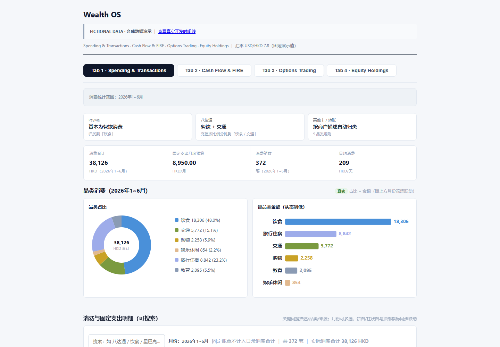
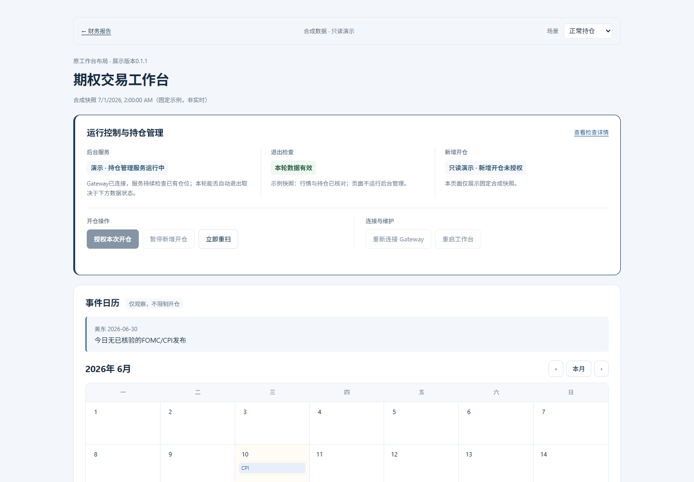

# Wealth Showcase

**可离线运行的个人财务看板 · 全部使用合成数据**

消费分析、月度现金流、FIRE 情景模拟、期权与股票展示。Python 负责计算和 HTML/SVG 生成，浏览器负责筛选、图表与交互，不依赖在线 CDN。

> 这是用于代码评估与作品展示的独立版本。财务和交易数据均为合成输入，期权页面沿用原工作台框架，执行操作已隔离。真实源项目的开发日期与短哈希另行保留，完整私人历史不随本仓库发布。

## 直接体验

下载本仓库后，打开 **[docs/index.html](docs/index.html)**。所有资源已内嵌，直接打开文件即可使用。

也可以[下载完整展示版 ZIP](https://github.com/JJDBanGe/wealth-showcase/archive/refs/heads/main.zip)，解压后打开上述文件。GitHub 文件页面会显示 HTML 源码，下载到本机才能直接体验页面交互。

- **消费**：六个月虚构交易，多月份筛选、分类图、搜索与明细。
- **现金流与 FIRE**：计算月口径、现金缓冲、大额支出模拟与复利路径。
- **期权**：月度现金流、合成组合及[原框架只读工作台](docs/workspace.html)，可切换正常持仓、行情过期、净仓差异及订单待确认四种状态。
- **股票**：合成持仓、行业分布、回撤与仓位图。
- **开发历程**：[六个功能演进节点](docs/timeline.html)，完整的 133 条源提交元数据默认折叠；说明见 [历史导出说明](docs/DEVELOPMENT_HISTORY.md)。





## 重新生成与验证

需要 Python 3.14 或更新版本。生成报告无需第三方运行依赖，也无需网络、银行文件或券商账户。

```shell
python scripts/gen_report.py
python -m pip install -r requirements-dev.txt
python -m pytest tests/ -v
```

生成 `docs/index.html`、`docs/workspace.html` 和 `docs/timeline.html`。生成时不读取 `.env` 或 `INVESTMENT_DATA_ROOT`，不注册浏览器协议，不启动后台进程，不访问券商及行情服务。

## 值得查看的实现

评审时可先体验月份筛选、搜索、FIRE 情景切换，再进入期权工作台查看候选、持仓腿、订单结算及异常场景。代码建议按 `core.py` → `charts.py` → `report.py` → `tests/` 阅读；工作台的原模板与公开版数据适配器放在 `demo/` 中。

| 文件 | 职责与取舍 |
| --- | --- |
| `src/wealth_os/core.py` | 无文件读写的计算层，月度口径隔离、复利、现金缓冲及净仓还原 |
| `src/wealth_os/charts.py` | 内嵌 SVG，可离线查看；消费图宽度与纵向布局保持一致 |
| `src/wealth_os/report.py` | 四个页面、筛选、悬停与情景交互；参数由 Python 注入 |
| `src/wealth_os/config.py` | 演示常量；不读取个人配置或账户信息 |
| `demo/fixtures.py` | 固定随机种子生成虚构数据，可复现 |
| `demo/templates/workspace.html` | 沿用源工作台的CSS、页面结构与显示函数；已移除真实状态和操作接口 |
| `demo/workspace.py` / `demo/workspace_adapter.js` | 合成状态与场景切换，驱动原工作台显示逻辑 |
| `demo/journey.py` | 有真实提交依据的功能节点，完整提交元数据默认折叠 |
| `tests/` | 通用计算回归、净仓核对、数据隔离、离线生成及脚本验证 |

生成器先完成计算，再交给报告层展示。报告采用完整写入后原子替换，避免失败时留下半份文件。第三方 UI 框架并非这个离线文档场景的必要条件；本项目选择 Python + 内嵌 SVG/JavaScript 以简化运行和分发。

## 开发过程与范围

这是私有个人项目的独立展示版，复用通用计算、图表与报告实现。源项目中的姓名、转账对象、真实账本、个人财务参数、设备指纹、交易授权及部署记录未随本仓库分发。

源项目通过 AI 辅助开发。提交数量用于说明迭代历程，不表示全部代码由手工逐行编写，也不等于独立功能数量。时间线由真实 Git 元数据导出，不是重新制造的提交历史。公开仓库后续会积累自己的提交。

工作台复用源项目模板、原CSS和显示函数，移除了真实状态请求、后台操作与轮询，改由合成快照驱动。运行控制、日历、资金、保证金、检查表、候选、持仓、订单及审计区均保留；交易/维护按钮只读，日历、详情折叠和场景切换可操作。未包含交易引擎、持久化、重连或真实下单能力。股票与期权数据不代表作者持仓或业绩；收益曲线由合成日收益计算，该示例无外部入出金，因此 TWR 与 MWR 相等。基本面缺失状态明确保留。FIRE 结果仅用于演示计算，不是投资建议。

[验证记录](docs/VALIDATION.md) · [数据与脱敏范围](docs/PRIVACY.md) · [发布说明](docs/PUBLISHING.md)

## 使用权

源项目保留所有权利。本仓库用于代码评估与作品展示，暂未授予开源许可证；公开可见不代表授权复制、修改或商业再分发。
